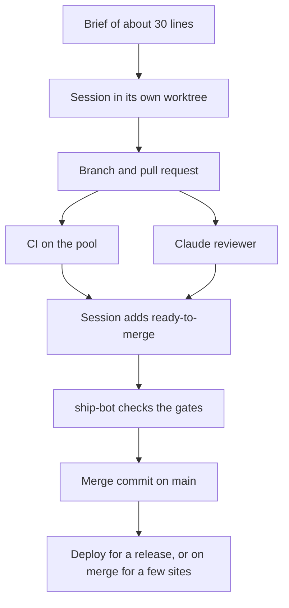
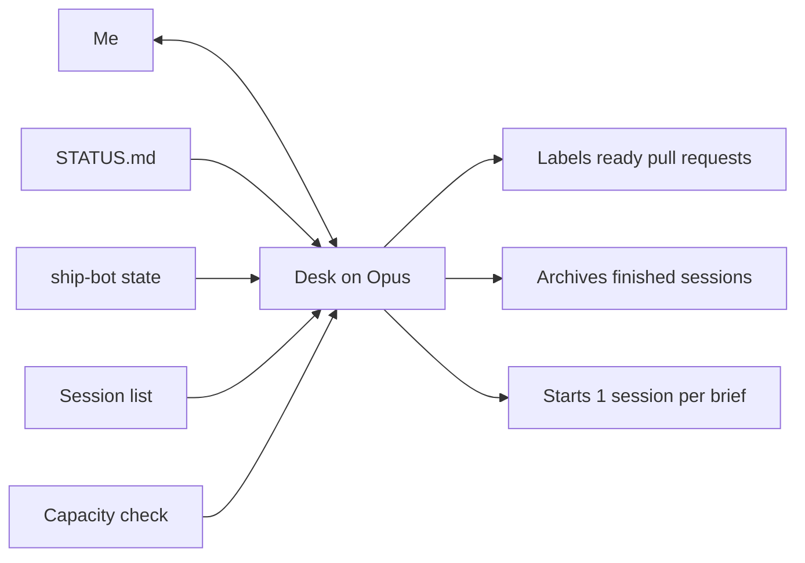

# Running the fleet

My sites and repositories are run by 1 person and a set of Claude Code agents. This page follows a change from brief to deploy. It also covers the model tiers, the continuous integration (CI) pool and the checks behind each merge.

## Path of a change

Every change follows the same path from a brief to a merged pull request (PR).



## Desk

Desk is the 1 session I talk to.

- Runs on Opus as 1 long-lived control session and owns no code work
- Keeps Remote Control on, so I can talk to it from my phone
- Reads a generated status file, ship-bot's state and the session list
- Labels ready PRs, archives finished sessions and starts 1 session per brief
- Rotates past 300,000 tokens and is never forked

On rotation a skill writes the day's log and starts a successor from the same brief with Remote Control on. Then it retires the old session.



The status file is `STATUS.md` on the `status` branch of this repository. A job called fleet-status rebuilds it daily from open PRs, lapsed backlog items and red main branches. Hand counts are never used.

## Briefs and sessions

- Briefs are files of about 30 lines in a private repository
- A session reads only its brief and its backlog entry
- Every session starts on Sonnet unless its brief names another model
- A session ends when its PR merges
- Chats are capped near 200,000 tokens. Then a handoff file goes into the repository and a new chat continues.
- Context that must outlive a session is kept in the repository: handoff files and a `## Next` checklist on the open PR
- Results come back through artifacts only: that `## Next` section, the status file and ship-bot notifications
- No session relays another's notes

## Worktrees and capacity

- Each agent that writes files gets its own git worktree
- Builders get a fresh worktree. Their work merges back with a squash.
- `git stash` is never run in a shared clone

A capacity check runs every 15 minutes. It reads load average against core count, free memory and working sessions. Desk gets a count of free slots and a state: `headroom`, `steady` or `hold`. Builders hold while the machine is loaded. [Read the capacity README](../capacity/README.md).

## Long runs in Herdr

Herdr is a terminal multiplexer app with a command line called `hc`. Anything slow runs in a named Herdr terminal, so it outlives the turn and the app.

- Gates, `gh run watch`, captures, dev servers and device builds run there
- `hc run --bg --name <name>` starts a run and `hc wait` waits on it
- Full local gates share 1 lock called `gate-run`, so the Mac runs at most 1 at a time
- A second caller gets exit 75 and waits
- A load check called `builder-ok` runs before each builder starts

## Model tiers

Each task goes to the cheapest tier that does it properly. A cheaper tier is wrong where its mistake would pass unnoticed.

| Tier | Work |
|------|------|
| Fable 5.2 | Reviewer on every builder diff, editor for anything a visitor reads, security assertions, design decisions, changes to what CI enforces, ship-bot logic |
| Opus 5.5 | Desk, root-cause investigations, infrastructure changes, backlog triage. No reviewer checks this work. |
| Sonnet 5.5 | Builders for features, first-draft tests, refactors and handoffs. Fable reviews the diff, so a mistake gets caught. |
| Haiku 5.5 | Gate runs, reruns, git, label sweeps and mechanical edits a compiler or test checks. Read-only scouts do inventories and broad searches. |

- Each plan item names its agent and model
- Push, tag and anything irreversible run only in the main session
- A builder on its 4th review round stops and hands back

## Pull requests and the reviewer

- Every change is a branch and a PR. A draft is fine.
- Nothing is committed to `main` directly
- Related small changes are batched into 1 PR
- Release trains take several reviewed PRs through 1 full CI run
- Every open PR has a `## Next` list
- A draft whose first unchecked line says merge is Desk's or ship-bot's to ready and label once gates pass

The Claude reviewer runs from `claude-review.yml`. [Read REVIEW.md](../REVIEW.md) for its house rules.

- Reviews a PR when it opens or leaves draft
- Runs again on a `claude review` comment
- Never runs code from the checkout under review

A merge gate reads its verdict as `clean`, `findings` or `not-run`. [Open scripts/review-status.mjs](../scripts/review-status.mjs).

- A push that only merges `main` cleanly needs no new review
- A PR that touches control-plane paths needs a new clean review of a new head for any medium or high finding. A reply doesn't lift it.

## ship-bot

The only merger is ship-bot. In the agents' settings `gh pr merge` is denied.

- Runs on a Mac under launchd every 2 minutes and uses no GitHub Actions minutes
- Merges with merge commits only and leaves GitHub auto-merge off

Sessions label a PR `ready-to-merge` once the gates pass. Then ship-bot merges it, but only when every line here is true:

- The PR is mine, out of draft and labelled `ready-to-merge` with no `hold` label
- Every expected check passed on the latest commit
- The reviewer reviewed the latest commit and found nothing, or every comment is answered
- The description has no closing keyword that would close an issue by accident

Behind those gates are 3 scripts: `assert-checks-started`, `review-status.mjs` and `check-closing-keywords`. The first catches a workflow that failed to start. Such a workflow shows no checks at all, so the panel looks quiet and never turns red.

Merging and deploying are separate.

- A plain merge isn't deployed
- A release is a PR labelled `release`. Before it deploys the full gate runs on my Mac and the built site is smoked locally. Its notes list the changes and name the gate's log. They also say what the smoke test read on a local or preview host.
- A few sites deploy on every merge
- A failed live check puts the previous version back where a site has a rollback. Either way ship-bot stops touching that repository until someone looks.
- Static sites deploy as immutable releases that can be rolled back. [Read the site deploy notes](site-deploy.md).

A janitor runs daily. It deletes merged branches, prunes clean worktrees and archives sessions. Docs-only PRs that pass the gates get its label, unless they touch control-plane paths. [Open the janitor folder](../janitor/). [Read the ship-bot README](../ship-bot/README.md).

## CI pool

By default CI jobs run on a self-hosted pool of machines I own. That covers tests, builds, end-to-end runs, smoke checks, deploys and alerts.

- Each repository picks pool or hosted through a variable called `HEAVY_RUNS_ON`
- A supervisor writes a heartbeat every 5 minutes
- Hosted runners take the reviewer, roll-up jobs and the pool-liveness check. That check has to run off the pool to notice the pool is down.
- A billing budget sets a monthly cap on hosted minutes
- Important work goes hosted when the heartbeat is stale or the oldest queued job has waited over 15 minutes. It returns to the pool when the queue clears.

Only the supervisor decides that a job was lost to its runner.

- A loss needs GitHub's lost-communication result with no failed step, plus a stale heartbeat
- A lost job reruns once with first claim on other pool hosts
- After a 2nd loss on the same head nothing reruns it. A person finds the cause.
- A failed step, a timeout or a cancel is never a loss

Test jobs that near their timeout are split into more shards. The timeout isn't raised and the executed-test floor stays the same.

## Verification floor

The floor is 5 rules.

1. Count what ran. A fully skipped suite exits 0, so each suite asserts an executed-test floor.
2. Fail closed on selection. An unmatched filter or an empty file list is an error.
3. Put `if: ${{ !cancelled() }}` on every assertion step. GitHub defaults a step to `success()`.
4. Watch a new guard fail once. Then narrow what it searches.
5. Fail a PR check only on something that PR can change. Dates, the network and other repositories belong in scheduled reports.

When CI is red I find the cause before making it green. A check is never weakened to go green.

- [Read the verification rules](verification-rules.md)
- [See the retired checks](retired-checks.md)
- [Read FLEET.md](../FLEET.md) for which repositories run the baseline and at what tier

## Privacy guard

This repository is public and every branch is readable.

- A `privacy-guard` check fails a PR that adds private detail: addresses, session ids, private repository names, internal hosts or emails
- A push guard runs the same check before a push
- [Open scripts/privacy-guard.mjs](../scripts/privacy-guard.mjs)

## AI use on every commit

Every commit an agent writes ends with 2 trailer lines after `Co-Authored-By`. The third line here is an example of the first.

```text
AI-Use: <level> <hand> <door> [unread] (<tool>)
AI-Use-Standing: <url> <date>
AI-Use: L3 made undo unread (Claude Sonnet 5.5)
```

- `level` is how much I approved beforehand
- `hand` is how much the agent made
- `door` says whether the change can be undone
- `unread` means I didn't read the diff before the commit

The second line points at my public delegation note, because I delegated the tag to the sessions. [Read the delegation note](https://github.com/gorfednet/ai-use-levels/blob/main/docs/delegation.md). The spec is public at [gorfednet/ai-use-levels](https://github.com/gorfednet/ai-use-levels).

Pages on heuristics.4thcltr.com and papers.4thcltr.com have a tag too. CI fails a page with changed content and an untouched tag.

AI Use: L3 · made · undo · unread · Claude Fable 5.2 + Claude Sonnet 5.5

[Read more about AI Use Levels](https://github.com/gorfednet/ai-use-levels)
